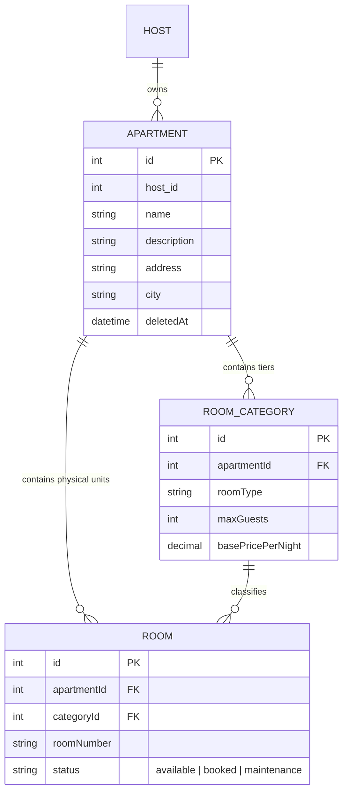

# ApartmentService Microservice

The core property and inventory catalog service of the Airbnb Clone platform. Built with Express 5, TypeScript (strict mode), and Sequelize ORM on MySQL, this microservice handles apartment listing lifecycles, tiered room category configurations, concrete room unit allocations, and host ownership authorization.

---

## Architecture & Domain Model



---

## Core Features & Business Logic

### 1. Host Ownership Authorization (`services/apartment.service.ts`)
- **Host Binding**: Whenever an apartment listing is created, `req.user.id` is extracted from the gateway header (`X-User-ID`) and permanently recorded as `host_id`.
- **Ownership Verification**: Modifying categories, creating physical rooms, or deleting apartments strictly validates that the requesting host owns the listing (`apartment.host_id === requestingHostId`), returning `403 Forbidden` on unauthorized attempts.
- **Soft Deletion**: Implements paranoid deletion (`deletedAt`) to preserve historical booking data integrity.

### 2. Nested Sub-Resource Routing (`routers/v1/roomCategory.router.ts`)
- Utilizes `express.Router({ mergeParams: true })` to capture parent path parameters from `/apartments/:apartmentId/categories`.
- Enables clean RESTful URL hierarchies without redundant parameter extraction.

### 3. Room Inventory & Integrity Enforcement (`services/room.service.ts`)
- **Status State Machine**: Enforces strict transitions across room lifecycle states (`available`, `booked`, `maintenance`).
- **Cross-Entity Integrity Guard**: Before adding a physical room unit, the service verifies that `category.apartmentId === apartment.id`. This prevents cross-listing category hijacking where a host attempts to attach rooms to another host's pricing tier.

### 4. Gateway Identity Middleware (`middlewares/auth-context.middleware.ts`)
- **`extractUserContext`**: Parses and validates `X-User-ID` and `X-User-Email` headers forwarded from the API Gateway, attaching typed user identity to Express's `req.user`.
- **`requireUserContext`**: Rejects unauthenticated requests with `401 Unauthorized`.

---

## API Catalog

| Method | Endpoint | Access | Description |
| :--- | :--- | :---: | :--- |
| `GET` | `/api/v1/ping/:id` | Public | Healthcheck and ping diagnostic |
| `GET` | `/api/v1/apartments` | Public | List all active apartment listings |
| `GET` | `/api/v1/apartments/:id` | Public | Retrieve detailed apartment by ID |
| `POST` | `/api/v1/apartments` | Host | Create new apartment listing |
| `DELETE` | `/api/v1/apartments/:id` | Host | Soft-delete owned apartment listing |
| `GET` | `/api/v1/apartments/:id/categories` | Public | List room categories for an apartment |
| `POST` | `/api/v1/apartments/:id/categories` | Host | Create room category for an apartment |
| `GET` | `/api/v1/categories/:id` | Public | Retrieve room category details |
| `PUT` | `/api/v1/categories/:id` | Host | Update room category pricing and capacity |
| `POST` | `/api/v1/categories/:id/rooms` | Host | Add concrete room unit to inventory |
| `GET` | `/api/v1/rooms/:id` | Public | Retrieve physical room unit details |
| `PUT` | `/api/v1/rooms/:id/status` | Host | Transition room status (`available`/`booked`/`maintenance`) |

---

## Database Migrations (Sequelize CLI)

Migrations are located in `src/db/migrations/`:
1. `20260516000001-create-apartments.ts`
2. `20260516000002-create-room-categories.ts`
3. `20260516000003-create-rooms.ts`
4. `20260516151232-add-apartmentid-to-roomcategory.ts`
5. `20260516160000-add-hostid-to-apartments.ts`

Run migrations:
```bash
npm run migrate
```

Rollback last migration:
```bash
npm run rollback
```

---

## Environment Variables

| Variable | Default | Purpose |
| :--- | :--- | :--- |
| `PORT` | `3000` | Service HTTP listen port |
| `DB_NAME` | `airbnb_apartment` | MySQL database name |
| `DB_USER` | `root` | Database username |
| `DB_PASSWORD` | `root` | Database password |
| `DB_HOST` | `127.0.0.1` | MySQL host address |

---

## Development & Verification

### Strict TypeScript Typecheck
```bash
./node_modules/.bin/tsc --noEmit
```

### Build Production Bundle
```bash
npm run build
```

### Start Development Server
```bash
npm run dev
```
