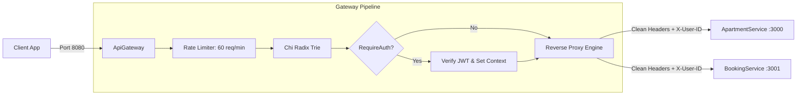

# ApiGateway Microservice

A high-throughput, edge reverse proxy and authentication gateway built in Go using the Chi router. The API Gateway functions as the unified security perimeter for the Airbnb Clone platform, terminating external client traffic, enforcing IP rate limiting, validating JWT tokens, and transparently proxying requests to downstream microservices with zero-trust header cleansing.

---

## Architectural Role



---

## Core Features & Mechanics

### 1. Reverse Proxy Engine (`utils/proxy.go`)
- **Go 1.20+ `Rewrite` Hook**: Built on `httputil.ProxyRequest` and `proxy.Rewrite`, cleanly separating inbound client state (`r.In`) from outbound downstream state (`r.Out`).
- **Zero-Trust Header Cleansing**: Explicitly strips incoming `X-User-ID` and `X-User-Email` headers from the client before inspecting request context, preventing identity injection attacks.
- **Context Identity Forwarding**: Injects verified user identity (`X-User-ID`, `X-User-Email`) and tracing headers (`X-Correlation-ID`) into downstream requests.
- **Dynamic Path Rewriting**: Implements `PrefixRewriter(oldPrefix, newPrefix)` to seamlessly map public gateway paths (e.g. `/properties/*`) to downstream paths (`/api/v1/apartments/*`) without client contract changes.
- **Connection Pooling**: Configures a dedicated `http.Transport` with connection reuse (`MaxIdleConns: 100`, `IdleConnTimeout: 90s`, `ResponseHeaderTimeout: 15s`).
- **Resilient Error Boundaries**: Catches downstream socket errors in `proxy.ErrorHandler` and returns uniform JSON `502 Bad Gateway` error envelopes.

### 2. Edge Authentication & Security (`middlewares/auth.go`)
- **JWT Verification**: Verifies HMAC-SHA256 Bearer tokens, populating `UserIDKey` and `UserEmailKey` into Go's request `context.Context`.
- **IP Rate Limiting**: Built on token bucket algorithms (`middlewares/ratelimit.go`) enforcing 60 requests per minute with a burst allowance of 10.
- **Password Security**: Hashes user credentials using `bcrypt` with cost factor 10.

---

## Route Catalog

| Method | Endpoint | Access | Handler / Downstream Target |
| :--- | :--- | :---: | :--- |
| `GET` | `/ping` | Public | Healthcheck ping (`controllers.PingHandler`) |
| `POST` | `/signup` | Public | User registration (`UserController.RegisterUser`) |
| `POST` | `/signin` | Public | User authentication (`UserController.LoginUser`) |
| `GET` | `/users/profile` | Protected | Authenticated user profile lookup |
| `GET` | `/users/{id}` | Protected | Specific user lookup |
| `GET` | `/api/v1/apartments/*` | Public | Proxied to ApartmentService (`:3000`) |
| `POST` | `/api/v1/apartments/*` | Protected | Proxied to ApartmentService (`:3000`) |
| `PUT` | `/api/v1/apartments/*` | Protected | Proxied to ApartmentService (`:3000`) |
| `DELETE` | `/api/v1/apartments/*` | Protected | Proxied to ApartmentService (`:3000`) |
| `GET` | `/properties/*` | Public | Rewritten to `/api/v1/apartments/*` and proxied |
| `ALL` | `/api/v1/bookings/*` | Protected | Proxied to BookingService (`:3001`) |

---

## Environment Variables

| Variable | Default | Purpose |
| :--- | :--- | :--- |
| `PORT` | `:8080` | Gateway HTTP listen port |
| `DB_NAME` | `airbnb_apiGateway` | MySQL database name |
| `DB_ADDR` | `127.0.0.1:3306` | MySQL host and port |
| `DB_USER` | `root` | Database username |
| `DB_PASSWORD` | `root` | Database password |
| `DB_NET` | `tcp` | MySQL connection protocol |
| `JWT_SECRET` | `TOKEN_SECRET` | Secret key for signing and verifying JWT tokens |
| `APARTMENT_SERVICE_URL` | `http://localhost:3000` | Target URL for ApartmentService |
| `BOOKING_SERVICE_URL` | `http://localhost:3001` | Target URL for BookingService |

---

## Development & Testing

### Running Tests
```bash
go test -v ./...
```

Tests cover:
- Anti-spoofing header sanitization and JWT context injection (`utils/proxy_test.go`).
- Path prefix rewriting and query parameter preservation (`utils/proxy_test.go`).
- Downstream connection refusal `502 Bad Gateway` error formatting (`utils/proxy_test.go`).
- Chi route group authorization and reverse proxy dispatch (`routers/router_test.go`).

### Running Locally
```bash
go run main.go
```

### Building Container
```bash
docker build -t airbnb-api-gateway .
```
