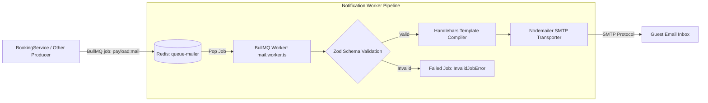

# NotificationService Microservice

The asynchronous messaging and email delivery worker of the Airbnb Clone platform. Built with Express 5, TypeScript (strict mode), BullMQ, Handlebars, and Nodemailer, this service processes background job queues from Redis, validates schema contracts, compiles dynamic HTML templates, and delivers transactional emails over SMTP.

---

## Architectural Pipeline



---

## Core Engineering Patterns

### 1. Discriminated Union Contract (`src/validators/notification.validator.ts`)
Inbound job payloads are strictly parsed using Zod's `z.discriminatedUnion('templateId', [...])`. This guarantees compile-time and runtime type safety for template parameters:
- `booking-confirmation`: Requires `guestName`, `bookingId`, `propertyId`, `checkInDate`, `checkOutDate`, `totalGuests`, `bookingAmount`.
- `booking-cancellation`: Requires `guestName`, `bookingId`, `propertyId`, `reason`.
- `welcome`: Requires `name`, `appName`.

### 2. Handlebars Template Compilation (`src/services/mailer.service.ts`)
- Pre-compiled HTML templates located in `src/templates/mailer/`:
  - `booking-confirmation.hbs`: Formats check-in dates, checkout dates, guest count, and total charges.
  - `booking-cancellation.hbs`: Formats reservation cancellation notices and refund advisories.
- Build pipeline bundles static template assets: `mkdir -p dist/templates && cp -r src/templates/mailer dist/templates/mailer`.

### 3. Worker Resilience & Retries (`src/workers/mail.worker.ts`)
- **At-Least-Once Delivery**: Configured with exponential backoff retries (`attempts: 3`, delay: 2000ms).
- **Poison Message Isolation**: If a job payload violates Zod schema validation, the worker rejects the job with `InvalidJobError` without infinite retry loops.

---

## Job Payload Contracts

### Booking Confirmation Payload
```json
{
  "to": "guest@example.com",
  "subject": "Booking Confirmation - Reservation #101",
  "templateId": "booking-confirmation",
  "params": {
    "guestName": "Valued Guest",
    "bookingId": 101,
    "propertyId": 12,
    "checkInDate": "2026-11-01T14:00:00.000Z",
    "checkOutDate": "2026-11-05T10:00:00.000Z",
    "totalGuests": 2,
    "bookingAmount": 450
  }
}
```

### Booking Cancellation Payload
```json
{
  "to": "guest@example.com",
  "subject": "Booking Cancellation - Reservation #101",
  "templateId": "booking-cancellation",
  "params": {
    "guestName": "Valued Guest",
    "bookingId": 101,
    "propertyId": 12,
    "reason": "Cancelled by guest"
  }
}
```

---

## Environment Variables

| Variable | Default | Purpose |
| :--- | :--- | :--- |
| `PORT` | `3002` | Healthcheck HTTP server listen port |
| `REDIS_HOST` | `localhost` | Redis server hostname |
| `REDIS_PORT` | `6379` | Redis server port |
| `SMTP_HOST` | `localhost` | Outgoing SMTP host address |
| `SMTP_PORT` | `587` | SMTP port (587 TLS or 465 SSL) |
| `SMTP_USER` | - | SMTP authentication username |
| `SMTP_PASS` | - | SMTP authentication password |
| `SMTP_FROM` | `no-reply@airbnb-clone.local` | Default email sender address |

---

## Development & Verification

### Strict TypeScript Compilation & Asset Bundling
```bash
npm run build
```

### Run ESLint & Formatting Checks
```bash
npm run lint
npm run format:check
```

### Start Development Worker
```bash
npm run dev
```
